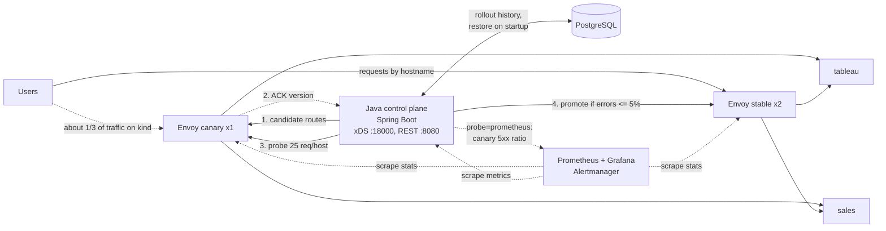

# Edge Control Plane

A small edge control plane in Java. It pushes routing config to a fleet of [Envoy](https://www.envoyproxy.io/) proxies over xDS, rolls every change out to a **canary** group first, probes it, and either **promotes** the change to the stable fleet or **rolls it back automatically**. A bad route never reaches users.

It's a scaled-down version of the problem an edge platform team solves: routing incoming requests to the right backend service, and changing that routing safely across many nodes.

## At a glance

| What | Result |
| --- | --- |
| [Canary rollout](#demo-output) | A good change is promoted in about 0.4 s, after the canary ACKs it over xDS and 75 of 75 probe requests pass. A route to a down backend fails 25 of 25 probes on the canary and rolls back; stable never sees it |
| [Cross-region failover on GKE](#cross-site-failover-kind-and-gke) | The local backend goes down: Envoy moves traffic from us-central1 to us-east1 in about 5 s with 0 failed requests, and back by itself |
| [Control plane outage](#control-plane-outage-kind) | Control plane down for 2 minutes under 200 req/s: 35,846 of 35,846 user requests succeed |
| [Self-optimizing routing](#self-optimizing-routing-kind) | Weight moves away from a slow backend (50/50 to 90/10) and a failing one is ejected, then re-admitted when health checks pass |
| [Auto-scaling](#auto-scaling-under-load-kind) | 1 to 16 pods under load: 4x the throughput, median latency 173 ms to 20 ms |
| [Live-site practice](docs/postmortem-2026-11-11-bad-route-promoted.md) | A runbook, and a postmortem of a real bad promotion found while building this |

See the demo in about 5 minutes with only Docker installed:

```bash
git clone https://github.com/vikrams3/edge-control-plane && cd edge-control-plane
docker compose up --build -d     # builds and unit-tests the control plane, starts 3 Envoys and the backends
./scripts/demo.sh                # press Enter between steps: promote, reject a typo, automatic rollback
docker compose down
```

Java 21, Spring Boot 3.5, [java-control-plane](https://github.com/envoyproxy/java-control-plane), Envoy, PostgreSQL, Kubernetes (kind and GKE), Prometheus and Grafana, Kafka Streams, Jenkins. 51 automated tests, including integration tests against a real Envoy and a real PostgreSQL.

## Architecture



- **Data plane:** Envoy. Each proxy starts with a tiny bootstrap (`envoy/envoy.yaml`) that only says where the control plane is. Listeners, routes and clusters all arrive over ADS.
- **Control plane:** Spring Boot plus [java-control-plane](https://github.com/envoyproxy/java-control-plane). It keeps one xDS snapshot per Envoy group. An Envoy's group is its `node.cluster`, set with `--service-cluster canary|stable`.
- **Rollout:** `POST /v1/rollouts` first rejects unknown backends with `400`. It then pushes the new route table to the canary group and waits until every canary Envoy ACKs that version over xDS (up to 5 s). Next it sends 25 test requests per hostname through the canary in parallel (virtual threads), and promotes or rolls back based on the error rate. A NACK, a timeout or no connected canary means an immediate rollback, with no probe.
- **Probes:** only the hostnames a change adds or re-points are probed (all of them if nothing changed), so a broken route is not diluted by healthy ones. Three `HealthProbe` strategies, chosen with `edge.probe`:
  - `synthetic` (the default): 25 test requests per hostname through the canary. Fast, and needs no traffic.
  - `prometheus`: watches real user traffic on the canary for 30 s and asks Prometheus for its 5xx ratio. It only knows the canary as a whole.
  - `kafka`: real traffic per hostname, from Envoy access logs streamed through Kafka (below). A hostname with fewer than 10 real requests in the window, such as a brand-new one, gets synthetic requests instead.
  - Every probe fails closed: no evidence counts as a failure.
- **Observability (kind):** Prometheus scrapes every Envoy (labelled by group) and the control plane's Micrometer metrics. Grafana has an "Edge control plane" dashboard showing req/s, 5xx ratio and p99 per group and per backend, plus rollouts and connected Envoys. Alertmanager has three rules: 5xx above 5%, stable Envoys disconnected, control plane down. Every Envoy writes one JSON access-log line per request.
- **mTLS on xDS (kind):** the control plane serves xDS over TLS and requires an Envoy client certificate signed by a private xDS CA; Envoy accepts only a control plane whose certificate names `control-plane.edge.svc.cluster.local`. A client without a certificate is refused at the handshake. Docker Compose stays plaintext for simplicity.
- **TLS:** with a certificate in `certs/` (`./scripts/gen-certs.sh` makes a self-signed `*.edge.local` one), every Envoy also serves HTTPS on `:10443`. The certificate is not in the bootstrap: the control plane sends it as an SDS secret on the same ADS stream, and reads the files on every push, so rotating means updating the Secret and pushing. Both listeners share one route table, access log and stat prefix.
- **Cross-site failover:** a backend can name a `failover` address, the same service at another site (another region or cloud). Its Envoy cluster then has two priorities: the local endpoint is priority 0, the other site priority 1. Envoy health-checks both every 2 s and sends traffic to priority 1 only while priority 0 fails, then moves it back by itself. Requests that fail to connect in the seconds before the health check notices are retried on the other priority (`previous_priorities`), so users see no errors. The control plane only writes this config; failover and failback happen inside Envoy, even with the control plane down.
- **State:** every rollout is a row in PostgreSQL (Spring Data JPA, schema by Flyway). On startup the control plane restores the last promoted routes and continues version numbers from the database. `POST /v1/rollouts/{version}/revert` rolls out an earlier version's routes again, through the canary like any other change.

## Code tour

| File | What it does |
| --- | --- |
| `EdgeConfig.java` | Builds Envoy listeners (HTTP, and HTTPS with an SDS certificate), route table, clusters and JSON access log from a `hostname -> backend` map |
| `XdsServer.java` | gRPC ADS server; one snapshot per Envoy group |
| `ConfigAckTracker.java` | xDS callbacks that record which route version each Envoy ACKed or NACKed; rollouts wait on it |
| `RolloutService.java` | Validate, canary, wait for ACK, probe, promote or roll back; one rollout at a time (`ReentrantLock`, 409 otherwise) |
| `HealthProbe` / `SyntheticHealthProbe` / `PrometheusHealthProbe` / `KafkaHealthProbe` | Strategy for measuring canary health: synthetic requests on virtual threads, the canary's 5xx ratio from Prometheus, or per-hostname real traffic from the analytics service |
| `TrafficOptimizer` / `TrafficWeights` / `OptimizerProperties` | Self-optimizing split of a backend pool by live p99 and 5xx, with guardrails; the split is stored in PostgreSQL |
| `XdsTlsProperties` | mTLS for the xDS gRPC channel |
| `BackendOptions` | Per-backend route options, such as no route timeout plus an idle timeout for streaming backends |
| `streaming/` | Mock LLM backend (Spring WebFlux): server-sent events, one token per 100 ms |
| `analytics/` | Separate Kafka Streams service: Envoy access logs to per group, hostname and backend request count, 5xx and latency histogram, in 5 s windows; `GET /v1/stats` |
| `RolloutPolicy` / `ErrorRatePolicy` | Strategy for the promote decision; today an error-rate threshold (5%) |
| `RolloutEntity` / `RolloutRepository` | JPA entity and Spring Data repository for the `rollouts` table (routes stored as `jsonb`) |
| `db/migration/V1__rollouts.sql` | Flyway migration that creates the schema |
| `RolloutController.java` | REST API (below), documented with springdoc-openapi |

## API

A rollout can take 40 s with the Prometheus probe, so starting one is asynchronous: `202 Accepted` with a `Location` to poll. Add `?wait=true` to block and get the final result with `200` instead; the demo script does this. The OpenAPI spec is at `/v3/api-docs` and Swagger UI at `/swagger-ui.html`.

| Method and path | Returns |
| --- | --- |
| `GET /v1/routes` | Current routes on the stable and canary groups |
| `POST /v1/rollouts` | `202` + `Location` (or `200` with `?wait=true`); `400` empty table or unknown backend; `409` a rollout is running |
| `GET /v1/rollouts/{version}` | One rollout: `in_progress`, `promoted` or `rolled_back`; `404` if unknown |
| `GET /v1/rollouts` | Every rollout, oldest first, including one in progress |
| `POST /v1/rollouts/{version}/revert` | Same codes as `POST /v1/rollouts`, plus `404` for an unknown version |

One rollout at a time is enforced with a `Semaphore`, not a lock: the request thread acquires it, and the virtual thread that finishes the rollout releases it.

## Run it

You need Docker Desktop on your Mac. Java and Maven are optional, because the image build compiles and tests the code inside Docker.

### Option A: Docker only (fastest)

```bash
./scripts/gen-certs.sh        # optional: enables HTTPS on :10443 (kind-up.sh does this itself)
docker compose up --build -d
./scripts/demo.sh
docker compose down
```

### Option B: Kubernetes with kind

```bash
brew install kind kubectl
./scripts/kind-up.sh        # cluster, build, deploy, metrics-server, Prometheus/Grafana, Kafka, port-forward
                            # (MONITORING=0 / KAFKA=0 skip those parts)
./scripts/demo.sh
./scripts/loadtest.sh       # optional: 4 minutes of load, watch the HPA scale tableau
kind delete cluster --name edge
```

On kind, Grafana is at `localhost:3000` (admin/admin, dashboard "Edge control plane"), Prometheus at `:9090` and Alertmanager at `:9093`. To use the real-traffic probe: `kubectl -n edge set env deploy/control-plane EDGE_PROBE=prometheus`.

### Option C: GKE, with a failover site in a second region

```bash
./scripts/gke-up.sh                                  # about 10 minutes the first time
CONTEXT=gke-primary ./scripts/failover-demo.sh       # local sales down, then back
./scripts/gke-down.sh                                # delete everything, so nothing keeps billing
```

`gke-up.sh` builds amd64 images on the Mac (Maven runs natively; only the run stage is amd64), pushes them to Artifact Registry, and creates:

| Resource | Where | Cost |
| --- | --- | --- |
| Zonal GKE cluster `edge-primary`, one spot e2-standard-4 node, the same manifests as kind | us-central1-a | Cluster fee covered by the GKE free tier; node about $0.04/hour |
| Spot e2-small VM `edge-dr-sales` running `sales`: the failover site | us-east1-b | About $0.01/hour; no public IP, pulls through Private Google Access |
| Firewall rule: only the cluster's pod range may reach the VM on 8080 | VPC | Free |

About $0.05/hour in total. Monitoring and Kafka are not installed on GKE, and Managed Prometheus and workload log ingestion are off, because they bill separately. The failover site is a plain VM, not a second cluster: a second cluster's fee ($0.10/hour) would cost more than everything else together, and a VM elsewhere is also what an AWS site would look like to Envoy.

Both options A and B expose the control plane on `localhost:8080`, the stable Envoy on `localhost:10000` (HTTPS `:10443`) and the canary Envoy on `localhost:10001`. Try `curl --cacert certs/tls.crt --resolve sales.edge.local:10443:127.0.0.1 https://sales.edge.local:10443/`. Envoy's admin page is useful for debugging: `localhost:9901/config_dump` in Docker mode.

## Tests and CI

| Command | What runs |
| --- | --- |
| `docker build ./control-plane` | 39 unit tests (the image does not build if one fails) |
| `./scripts/integration-test.sh` | Unit tests plus 12 integration tests with Testcontainers: a real Envoy ACKs our config, routes by hostname, and NACKs an invalid route while it keeps serving the last good one; a real PostgreSQL with the Flyway schema |
| `./scripts/integration-test.sh` also runs `ApplicationWiringIT` | Starts the whole app with real PostgreSQL once per probe setting and with the optimizer on. It catches bean wiring errors (it failed with `No default constructor found` when the postmortem's fix was removed, and caught a second instance later) |
| `./scripts/smoke-test.sh` | Against the running kind cluster: health, promote, 400 on a typo, rollback, stable unaffected, HTTPS |
| `./scripts/jenkins-up.sh` | Local Jenkins at `localhost:8090` (admin/admin), configured as code. The `Jenkinsfile` builds committed `main` (all three services, in parallel, each running its unit tests), runs the integration tests, deploys per-build image tags to kind, smoke-tests them, and runs `kubectl rollout undo` on all three if the smoke test fails. `SIMULATE_SMOKE_FAILURE=1 ./scripts/jenkins-up.sh` exercises that rollback |

Tested both ways: build #2 deployed all three services as `:2` and passed the smoke test; build #3 with `SIMULATE_SMOKE_FAILURE` deployed `:3`, failed the smoke test on purpose, and `rollout undo` put all three back on `:2`.

Jenkins starts sibling containers on the host's Docker (image builds, Maven, Testcontainers), so the workspace is mounted at the same path inside Jenkins as on the host. Otherwise the bind mounts would point at paths that only exist inside the Jenkins container.

## Demo output

```text
==> Good change: add crm.edge.local -> sales. Expect: promoted
{"version":3,"routes":{...,"crm.edge.local":"sales"},"outcome":"promoted","canaryAck":"acked",
 "probeRequests":75,"probeFailures":0,"errorRate":0.0}
crm.edge.local on stable -> hello from sales

==> Typo in the backend name (salez). Expect: 400, rejected before any Envoy sees it
{"error":"invalid route table","problems":["sales.edge.local: unknown backend 'salez',
 expected one of [billing, sales, tableau]"]}  (HTTP 400)

==> Bad change: move crm.edge.local to billing, which is down. Expect: rolled_back
{"version":5,"routes":{...,"crm.edge.local":"billing"},"outcome":"rolled_back","canaryAck":"acked",
 "probeRequests":25,"probeFailures":25,"errorRate":1.0}
crm.edge.local on stable is still fine -> hello from sales
```

After a restart, `GET /v1/routes` still shows `crm.edge.local`, restored from PostgreSQL. Reverting to the bad version (`POST /v1/rollouts/5/revert`) is caught by the canary again and rolled back.

`billing` is a configured backend with zero running instances, so it stands in for a service that is down. A second rollout started while one is running gets `409 Conflict`. If no canary Envoy is connected, the rollout rolls back with `"canaryAck":"no_nodes"` and sends no probes.

## Real-time analytics with Kafka (kind)

```text
Envoy stdout (JSON access log) -> Fluent Bit (DaemonSet) -> Kafka topic envoy-access-logs
  -> analytics (Kafka Streams): key group|host|backend, 5 s tumbling windows,
     count + 5xx + latency histogram -> state store (GET /v1/stats) and topic route-stats
```

Histograms with fixed buckets can be merged, so 5-second windows sum to any range. That lets the probe ask "since the canary ACKed" instead of "the last full minute". Kafka is Strimzi 1.3 with one KRaft node, sized for a laptop. With `EDGE_PROBE=kafka`, a bad change shows exactly which hostname broke:

```text
Kafka: canary crm.edge.local served 39 requests in 30s, 39 were 5xx, p99 2000 ms
Kafka: canary tableau.edge.local served 30 requests in 30s, 0 were 5xx, p99 200 ms
Kafka: too little real traffic for [pay.edge.local]; synthetic probe: 25 of 25 failed
```

## Self-optimizing routing (kind)

`tableau.edge.local` can be routed to `tableau-pool`, which Envoy splits across `tableau-a` and `tableau-b` with `weighted_clusters`. Every 30 s, `TrafficOptimizer` reads each member's p99 on stable over the last minute, from the Kafka analytics, and moves weight toward the faster one. Guardrails:

- At most 10 points per step, and only after **two consecutive readings** propose the same move (one noisy reading moved traffic in an early version).
- Each member keeps at least 10% of traffic, so a slower one stays measured.
- It acts only on a p99 more than 20% worse, and only with at least 20 requests per member.
- **A failing member is ejected at once** (5xx at or above 50% over the last 20 s): weight 0, below the floor. Errors act immediately; latency waits for confirmation.
- **It comes back on health checks, not on users.** While a member is ejected, the control plane checks its health path directly every step and re-admits it with 10% after two passes in a row. Members without a health path are re-tested with 10% of real traffic instead, with backoff (60 s, 120 s, 240 s… up to 10 minutes), like Envoy's outlier detection.
- When the members are equal again, it drifts back to even.
- It never changes weights while a rollout is running, and the split survives a control plane restart (PostgreSQL).

`./scripts/optimizer-demo.sh` slows `tableau-b` by 300 ms, then heals it:

| Phase | Weights a / b | tableau p99 |
| --- | --- | --- |
| Both healthy | 50 / 50, holds ("within 20%") | 50 ms |
| `tableau-b` +300 ms | 60/40 → 70/30 → 80/20 → 90/10 over 2 min, then holds at the floor | 500 ms |
| `tableau-b` healed | back to 50 / 50 over the next 3 min | 50 ms |

With `BREAK=fail`, `tableau-b` returns 503 for every request instead:

| Phase | Result |
| --- | --- |
| `tableau-b` breaks | Ejected (100/0) within about 60 s |
| Control plane restarted mid-failure | Split before and after: 100/0, read back from PostgreSQL; `tableau-b` stays out because its health checks still fail |
| Still broken, about 3 minutes | **0 failed requests**: no user traffic is spent on re-testing it |
| Healed | Two passing health checks, then 10%, then back toward even after two agreeing readings: re-admitted in under 60 s |

An earlier version re-tested ejected members with 10% of real traffic and exponential backoff. Each re-test cost about 50 failed requests while the member stayed broken, and once it was fixed, recovery took 240 s or more because of the backoff. That remains the fallback for backends without a health path.

The honest result of the latency demo: the share of slow requests fell from 50% to 10%, but p99 did not improve, because 10% is far above 1%. The floor keeps the slow pool measured, so it can win traffic back, and that costs the tail. For a member that is clearly broken, Envoy outlier detection (eject it) is the better tool; the optimizer is for gradual shifts. One early step was also caused by noise (a coarse histogram bucket made 100 ms vs 50 ms look real), and reversed one step later. Requiring two agreeing readings before acting would remove that.

## Long-lived streaming, LLM-style (kind)

`llm.edge.local` routes to a WebFlux backend that streams a token every 100 ms for 20 s. `./scripts/stream-test.sh` opens concurrent streams through the stable Envoys:

| Setup | Result |
| --- | --- |
| Envoy defaults | 100 of 100 streams cut at about 16 s, after 149 of 200 tokens. The client saw status 200 and no error: a silently truncated answer |
| `backend-options: llm: {timeout: 0s, idle-timeout: 30s}` | 100 of 100 completed (20.0 s); 1,000 concurrent streams also all completed |
| Same, with an upstream that stalls (tokens 40 s apart) | Cut at exactly 30 s by the idle timeout, so a hung backend still cannot hold a connection forever |

Envoy's route timeout (15 s by default) covers the whole response, which is right for request/response APIs and wrong for streams. Streams need it off, plus an idle timeout. The synthetic probe had the same blind spot: it waited for the whole body, so every probe of a 20 s stream "timed out" and the first rollout of `llm.edge.local` was rolled back. It now judges the status line and headers, then closes the stream.

## Real-traffic canary and alerting (kind)

The `users` Deployment sends about 14 req/s to the `edge` Service, which spreads requests across all three Envoys. So the canary serves a third of real traffic. With `EDGE_PROBE=prometheus`:

| Change | Canary requests in 30 s | 5xx | Outcome | Rollout time |
| --- | --- | --- | --- | --- |
| Add `shop.edge.local -> tableau` | 137 | 0 | promoted | 40 s |
| Move `crm.edge.local` to `billing` (down) | 107 | 40 (37%) | rolled back | 40 s |

The trade-off: the synthetic probe finds a bad change before any user sees it, but only with fake requests. The real-traffic probe uses true signals, but a third of users hit the bad route for 40 seconds. Many teams run both, in that order. Scaling `sales` to zero fired `EdgeHigh5xxRate` in Alertmanager about 95 s later: 2-minute rate window plus 1 minute `for:`. `EdgeHostHigh5xxRate` alerts per hostname, from `edge_host_requests_total`, which the analytics service exports from the access logs (Envoy's stats are per cluster, not per hostname). Only routed requests are counted, because the Host header is client-controlled and counting every value would create unbounded metric series. Breaking `sales` fired it after 106 s for exactly `crm.edge.local` and `sales.edge.local`. A hostname nobody calls cannot alert; new hostnames are covered by the canary probe instead.

## Control plane outage (kind)

`./scripts/chaos-control-plane.sh` sends about 200 req/s through the stable Envoys for 2 minutes, and scales the control plane to zero for 60 s in the middle:

| | Result |
| --- | --- |
| User requests | 23,926 of 23,926 returned 200; 0 errors; p99 5.8 ms |
| Route changes during the outage | Impossible: the control plane API is unreachable |
| After it came back | It restored the last promoted routes from PostgreSQL, and all 3 Envoys reconnected within 22 s (Envoy's reconnect backoff) |
| Alerting (2-minute outage) | `EdgeControlPlaneDown` fired 107 s after the control plane went away: a missed scrape, the 30 s rule evaluation interval, then the rule's 1-minute `for:`. A 60 s outage recovers before it fires. Users saw 35,846 of 35,846 requests succeed in that run |

The data plane does not depend on the control plane being up, only on it being right when it is up. That is why the control plane can be deployed, restarted or lose its database without an outage for users.

## Auto-scaling under load (kind)

On Kubernetes, `tableau` burns about 8 ms of CPU per request (request 200m, no CPU limit) and has an HPA targeting 50% CPU, from 1 to 16 pods. `scripts/loadtest.sh` runs [hey](https://github.com/rakyll/hey) inside the cluster, through the stable Envoy, at 50 concurrent connections for four 60-second rounds:

| Minute | Ready pods | Requests/s | p50 (ms) | p99 (ms) | Failed |
| --- | --- | --- | --- | --- | --- |
| 1 | 1 | 173 | 173 | 1588 | 0 |
| 2 | 8 | 539 | 29 | 826 | 0 |
| 3 | 16 | 697 | 22 | 844 | 0 |
| 4 | 16 | 680 | 20 | 893 | 0 |

Scaling out gave 4x the throughput and cut median latency by 8x. The p99 stays near 850 ms because the laptop is now the limit: 16 pods at about 420m each, plus Envoy and the load generator, come close to its 8 CPUs, while the HPA still wants more pods (about 200% of target).

Getting here took three tuning runs. Each row is the steady state at the end of a run (raw output in `loadtest/`):

| Setup | Pods | Requests/s | p50 (ms) | p99 (ms) |
| --- | --- | --- | --- | --- |
| 500m CPU limit, max 8 pods | 8 | 339 | 50 | 1278 |
| 500m CPU limit, max 16 pods | 16 | 158 | 50 | 2145 |
| No CPU limit, max 16 pods | 16 | 450 | 50 | 588 |
| No CPU limit, Nagle off, max 16 pods | 16 | 680 | 20 | 893 |

## Cross-site failover (kind and GKE)

`./scripts/failover-demo.sh` sends 20 req/s to `sales.edge.local` through the stable Envoys from a pod in the cluster, scales the local `sales` to 0 pods at 20 s and back to 2 at 60 s, and counts which site answered every 5 s. On GKE the failover site is the VM in us-east1; on kind it is the namespace `edge-dr` (`k8s/failover-site/`).

GKE, us-central1 failing over to us-east1:

```text
  15s local=  96 failover=   0 errors=  0
[20s] local sales scaled to 0
  25s local=  13 failover=   7 errors=  0
  30s local=   0 failover=  51 errors=  0
  ...
[60s] local sales scaled to 2
  70s local=  49 failover=  27 errors=  0
  75s local=  96 failover=   0 errors=  0
```

| Run | Failover took | Failed requests | Failback |
| --- | --- | --- | --- |
| kind, health checks only | about 5 s | 18 | about 10 s, 0 errors |
| kind, plus retry on the other priority | about 5 s | 0 | about 10 s, 0 errors |
| GKE, us-central1 to us-east1 VM | about 5 s | 0 | about 10 s, 0 errors |

While failed over, each request takes about 35 ms longer (the client sends one at a time, so it completed 57 requests per 5 s instead of 96): that is the round trip from us-central1 to us-east1, the real price of serving from the other region. Failback waits for 3 passing health checks, so a backend that is still starting does not get traffic too early.

## What I learned

- **The data plane survives the control plane.** With the control plane stopped, Envoy keeps serving its last config. Separating the two is what makes the control plane safe to deploy.
- **Control plane state has to be durable.** The first version kept routes in memory. A restart pushed the initial routes again, and Envoy dropped every promoted change about 15 s later, after its reconnect backoff. Now every rollout is stored in PostgreSQL, and startup restores the last promoted routes. Version numbers continue from the database, so a restart never reuses one. A restored version whose backends are no longer configured is skipped, with a warning.
- **The canary caught a real capacity bug.** The first CPU-heavy tableau used Python's default listen backlog of 5. The probe sends 25 requests per host at once, so connections were reset: Envoy showed 33 `upstream_cx_connect_fail` and 33 `503`s, and even a good change rolled back. Raising the backlog and enabling keep-alive fixed it. The rollback was correct, because users would have seen those errors too.
- **"Pushed" is not "applied".** The first version slept 2 s after each push and hoped the canary had the new routes. Now the control plane watches xDS ACKs and NACKs, and starts probing as soon as every canary Envoy confirms the version. A good rollout went from about 2.1 s to 0.4 s, and a canary that is missing or rejects the config can no longer be probed on stale routes.
- **More pods did not help until the real bottlenecks were gone.** Raising the HPA cap from 8 to 16 lowered throughput, because each pod was throttled at its 500m CPU limit. Removing the limit (keeping the request the HPA scales on) took throughput from 339 to 450 req/s. The p50 still sat at exactly 50 ms, which I first blamed on throttling. That was wrong: one request at a time took 52 ms for 8 ms of work. Python writes headers and body separately, and on a kept-alive connection Nagle's algorithm plus delayed ACK held each reply about 40 ms. With `TCP_NODELAY` a request takes 8 ms through Envoy, and throughput reached about 690 req/s.
- **Kubernetes balances connections, not requests.** The first simulated users kept connections alive, and kube-proxy pinned them at random, so the canary got 16% of traffic instead of 33%. Opening a connection per request fixed the split. Real clients behave the same way, which is why a request-level canary split belongs in Envoy (`weighted_clusters`), not in the Service.
- **TLS added two surprises.** HTTPS clients on a non-default port send `Host: sales.edge.local:10443`, which matched no virtual host, so every request returned 404 until the connection manager set `strip_any_host_port`. Also, rotation is real: after `kubectl apply` of a new Secret, the kubelet took about 55 s to update the mounted files, and the next push served the new certificate without restarting Envoy. One caveat: the private key travels inside the xDS snapshot, so in production the xDS channel itself must use mTLS, or keys should come from a local SDS agent.
- **Health checks alone still drop requests.** Envoy needs two failed checks, about 4 s, to mark the local site down, and requests in that window failed (18 in the first kind run). A retry on `connect-failure` that skips the priority which just failed closed the gap to zero. Retrying on `reset` too can repeat a request the backend had started, which is fine for these read-only backends and wrong for writes.
- **Deleting a GKE cluster does not delete its disks.** The PersistentVolume behind Postgres outlives the cluster and keeps billing, so `gke-down.sh` deletes the namespace (and with it the claim and the disk) first.
- **A synthetic probe is a blunt instrument.** It only tests the hostnames in the change and only `GET /`. Real traffic metrics from Envoy (Prometheus) are the better signal.

## Compared with a managed CDN

CloudFront, Cloud CDN, Cloudflare and Akamai solve a different, bigger problem: a global network of points of presence with anycast, caching, DDoS absorption, WAF and TLS close to users. This project is the layer behind that: an L7 routing tier for your own services, where the interesting part is how configuration changes safely.

| | Managed CDN | This control plane + Envoy |
| --- | --- | --- |
| Where it runs | The provider's global edge | Your clusters, any cloud or on-prem |
| Best at | Caching, static and cacheable content, global reach, absorbing attacks | Routing by hostname to your own backends, custom logic, internal traffic |
| Config changes | Through the provider's API; their rollout, their safety checks | Your rollout: canary, xDS ACK, probe on your signals, automatic rollback, audit trail in your database |
| Signals | The provider's analytics | Your own: Prometheus, access logs in Kafka, per-hostname p99 |
| Traffic steering | Provider features (origin groups, load balancing products) | Anything you can compute: weighted pools moved by live p99, failover by Envoy priority |
| Cost model | Per request and per GB, operations included | Compute you run, and the engineers who run it |

**When I would use each:** a managed CDN in front for anything public, cacheable or attack-prone; an Envoy tier like this one behind it, or for internal and service-to-service traffic, when routing has to follow your own rules and your own signals. Many companies run both. Envoy is also the data plane inside several managed products, so the xDS model here is the same one those products use internally.

## Further reading in this repo

- [docs/runbook.md](docs/runbook.md): what each alert means and what to do, common tasks.
- [docs/postmortem-2026-11-11-bad-route-promoted.md](docs/postmortem-2026-11-11-bad-route-promoted.md): a real incident from building this: a probe judged a change on other hostnames' traffic, and a route to a down backend reached stable for 93 s.

## Roadmap

1. ~~**Operate it like production:** GKE.~~ Done: `scripts/gke-up.sh`.
2. **Multi-cloud:** failover by Envoy locality priority with active health checks is done and tested across GCP regions. Next: AWS as the failover site, which only changes the `failover` address (over a VPN or a private link, not the public internet).
3. **Hardening:** mTLS on xDS in Docker Compose too; a deeper health check than `/` for real backends.

## License

MIT
