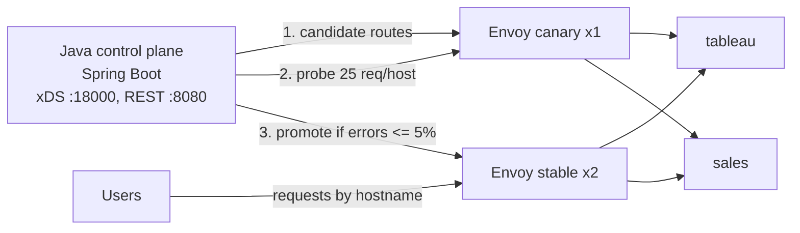

# Edge Control Plane

A small edge control plane in Java. It pushes routing config to a fleet of [Envoy](https://www.envoyproxy.io/) proxies over xDS, rolls every change out to a **canary** group first, probes it, and either **promotes** the change to the stable fleet or **rolls it back automatically**. A bad route never reaches users.

It's a scaled-down version of the problem an edge platform team solves: routing incoming requests to the right backend service, and changing that routing safely across many nodes.

## Architecture



- **Data plane:** Envoy. Each proxy starts with a tiny bootstrap (`envoy/envoy.yaml`) that only says where the control plane is. Listeners, routes and clusters all arrive over ADS.
- **Control plane:** Spring Boot plus [java-control-plane](https://github.com/envoyproxy/java-control-plane). It keeps one xDS snapshot per Envoy group. An Envoy's group is its `node.cluster`, set with `--service-cluster canary|stable`.
- **Rollout:** `POST /v1/rollouts` pushes the new route table to the canary group, waits 2 s, sends 25 test requests per hostname through the canary in parallel (virtual threads), then promotes or rolls back based on the error rate.

## Code tour

| File | What it does |
| --- | --- |
| `EdgeConfig.java` | Builds Envoy listener, route table and clusters from a `hostname -> backend` map |
| `XdsServer.java` | gRPC ADS server; one snapshot per Envoy group |
| `RolloutService.java` | Canary, probe, promote or roll back; one rollout at a time (`ReentrantLock`, 409 otherwise) |
| `HealthProbe` / `SyntheticHealthProbe` | Strategy for measuring canary health; today synthetic requests on virtual threads |
| `RolloutPolicy` / `ErrorRatePolicy` | Strategy for the promote decision; today an error-rate threshold (5%) |
| `RolloutController.java` | REST API: `GET /v1/routes`, `POST /v1/rollouts`, `GET /v1/rollouts` |

## Run it

You need Docker Desktop on your Mac. Java and Maven are optional, because the image build compiles and tests the code inside Docker.

### Option A: Docker only (fastest)

```bash
docker compose up --build -d
./scripts/demo.sh
docker compose down
```

### Option B: Kubernetes with kind

```bash
brew install kind kubectl
./scripts/kind-up.sh        # create cluster, build, deploy, metrics-server, port-forward
./scripts/demo.sh
./scripts/loadtest.sh       # optional: 4 minutes of load, watch the HPA scale tableau
kind delete cluster --name edge
```

Both options expose the control plane on `localhost:8080`, the stable Envoy on `localhost:10000` and the canary Envoy on `localhost:10001`. Envoy's admin page is useful for debugging: `localhost:9901/config_dump` in Docker mode.

## Demo output

```text
==> Good change: add crm.edge.local -> sales. Expect: promoted
{"version":3,"routes":{...,"crm.edge.local":"sales"},"outcome":"promoted",
 "probeRequests":75,"probeFailures":0,"errorRate":0.0}
crm.edge.local on stable -> hello from sales

==> Bad change: typo in the backend name (salez). Expect: rolled_back
{"version":5,"routes":{...,"sales.edge.local":"salez"},"outcome":"rolled_back",
 "probeRequests":75,"probeFailures":25,"errorRate":0.333}
sales.edge.local on stable is still fine -> hello from sales
```

A second rollout started while one is running gets `409 Conflict`.

## Auto-scaling under load (kind)

On Kubernetes, `tableau` burns about 8 ms of CPU per request (limit 500m) and has an HPA targeting 50% CPU, from 1 to 8 pods. `scripts/loadtest.sh` runs [hey](https://github.com/rakyll/hey) inside the cluster, through the stable Envoy, at 50 concurrent connections for four 60-second rounds:

| Minute | Ready pods | Requests/s | p50 (ms) | p99 (ms) | Failed |
| --- | --- | --- | --- | --- | --- |
| 1 | 1 | 58 | 627 | 3774 | 8 |
| 2 | 5 | 254 | 81 | 1370 | 0 |
| 3 | 8 | 339 | 50 | 1278 | 0 |
| 4 | 8 | 294 | 50 | 1422 | 0 |

Scaling out gave 5.8x the throughput and cut median latency by 12x, all on one laptop with 8 CPUs. The p99 stays above 1 s because the HPA hit its 8-pod maximum while CPU was still about 150% of target, and each pod is throttled at its 500m limit. Next steps: raise `maxReplicas`, and tune the CPU limit.

## What I learned

- **The data plane survives the control plane.** With the control plane stopped, Envoy keeps serving its last config. Separating the two is what makes the control plane safe to deploy.
- **Control plane state has to be durable.** When the control plane restarts, it pushes its initial routes again, so any promoted change is lost (Envoy picked up the reset routes about 15 s later, after its reconnect backoff). Next step: store every route version in PostgreSQL and restore the last promoted one on startup.
- **The canary caught a real capacity bug.** The first CPU-heavy tableau used Python's default listen backlog of 5. The probe sends 25 requests per host at once, so connections were reset: Envoy showed 33 `upstream_cx_connect_fail` and 33 `503`s, and even a good change rolled back. Raising the backlog and enabling keep-alive fixed it. The rollback was correct, because users would have seen those errors too.
- **A synthetic probe is a blunt instrument.** It only tests the hostnames in the change and only `GET /`. Real traffic metrics from Envoy (Prometheus) are the better signal.

## Roadmap

1. **Operate it like production:** PostgreSQL history and restore, Prometheus and Grafana with a 5xx alert, Envoy access logs, TLS termination with SDS, OpenAPI spec, Testcontainers test against a real Envoy, Jenkins pipeline, HPA under load, GKE.
2. **Analytics and self-optimizing:** Envoy access logs to Kafka, a Kafka Streams job computing per-route error rate and p99, the control plane shifting `weighted_clusters` toward the faster backend pool, long-lived streaming (LLM-style) load tests, cross-cloud failover from GKE to AWS by Envoy priority.

## License

MIT
