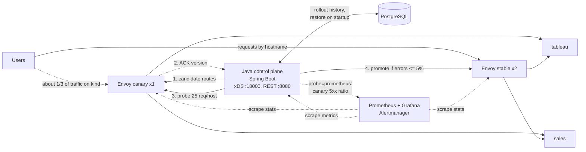

# Edge Control Plane

A small edge control plane in Java. It pushes routing config to a fleet of [Envoy](https://www.envoyproxy.io/) proxies over xDS, rolls every change out to a **canary** group first, probes it, and either **promotes** the change to the stable fleet or **rolls it back automatically**. A bad route never reaches users.

It's a scaled-down version of the problem an edge platform team solves: routing incoming requests to the right backend service, and changing that routing safely across many nodes.

## Architecture



- **Data plane:** Envoy. Each proxy starts with a tiny bootstrap (`envoy/envoy.yaml`) that only says where the control plane is. Listeners, routes and clusters all arrive over ADS.
- **Control plane:** Spring Boot plus [java-control-plane](https://github.com/envoyproxy/java-control-plane). It keeps one xDS snapshot per Envoy group. An Envoy's group is its `node.cluster`, set with `--service-cluster canary|stable`.
- **Rollout:** `POST /v1/rollouts` first rejects unknown backends with `400`. It then pushes the new route table to the canary group and waits until every canary Envoy ACKs that version over xDS (up to 5 s). Next it sends 25 test requests per hostname through the canary in parallel (virtual threads), and promotes or rolls back based on the error rate. A NACK, a timeout or no connected canary means an immediate rollback, with no probe.
- **Probes:** two `HealthProbe` strategies, chosen with `edge.probe`. `synthetic` (the default) sends 25 test requests per hostname through the canary, which is fast and needs no traffic. `prometheus` watches real user traffic on the canary for 30 s and asks Prometheus for its 5xx ratio. No traffic means no evidence, which counts as a failure.
- **Observability (kind):** Prometheus scrapes every Envoy (labelled by group) and the control plane's Micrometer metrics. Grafana has an "Edge control plane" dashboard showing req/s, 5xx ratio and p99 per group and per backend, plus rollouts and connected Envoys. Alertmanager has three rules: 5xx above 5%, stable Envoys disconnected, control plane down. Every Envoy writes one JSON access-log line per request.
- **State:** every rollout is a row in PostgreSQL (Spring Data JPA, schema by Flyway). On startup the control plane restores the last promoted routes and continues version numbers from the database. `POST /v1/rollouts/{version}/revert` rolls out an earlier version's routes again, through the canary like any other change.

## Code tour

| File | What it does |
| --- | --- |
| `EdgeConfig.java` | Builds Envoy listener (with a JSON access log), route table and clusters from a `hostname -> backend` map |
| `XdsServer.java` | gRPC ADS server; one snapshot per Envoy group |
| `ConfigAckTracker.java` | xDS callbacks that record which route version each Envoy ACKed or NACKed; rollouts wait on it |
| `RolloutService.java` | Validate, canary, wait for ACK, probe, promote or roll back; one rollout at a time (`ReentrantLock`, 409 otherwise) |
| `HealthProbe` / `SyntheticHealthProbe` / `PrometheusHealthProbe` | Strategy for measuring canary health: synthetic requests on virtual threads, or the canary's real 5xx ratio from Prometheus |
| `RolloutPolicy` / `ErrorRatePolicy` | Strategy for the promote decision; today an error-rate threshold (5%) |
| `RolloutEntity` / `RolloutRepository` | JPA entity and Spring Data repository for the `rollouts` table (routes stored as `jsonb`) |
| `db/migration/V1__rollouts.sql` | Flyway migration that creates the schema |
| `RolloutController.java` | REST API (below), documented with springdoc-openapi |

## API

A rollout can take 40 s with the Prometheus probe, so starting one is asynchronous: `202 Accepted` with a `Location` to poll. Add `?wait=true` to block and get the final result with `200` instead; the demo script does this. The OpenAPI spec is at `/v3/api-docs` and Swagger UI at `/swagger-ui.html`.

| Method and path | Returns |
| --- | --- |
| `GET /v1/routes` | Current routes on the stable and canary groups |
| `POST /v1/rollouts` | `202` + `Location` (or `200` with `?wait=true`); `400` empty table or unknown backend; `409` a rollout is running |
| `GET /v1/rollouts/{version}` | One rollout: `in_progress`, `promoted` or `rolled_back`; `404` if unknown |
| `GET /v1/rollouts` | Every rollout, oldest first, including one in progress |
| `POST /v1/rollouts/{version}/revert` | Same codes as `POST /v1/rollouts`, plus `404` for an unknown version |

One rollout at a time is enforced with a `Semaphore`, not a lock: the request thread acquires it, and the virtual thread that finishes the rollout releases it.

## Run it

You need Docker Desktop on your Mac. Java and Maven are optional, because the image build compiles and tests the code inside Docker.

### Option A: Docker only (fastest)

```bash
docker compose up --build -d
./scripts/demo.sh
docker compose down
```

### Option B: Kubernetes with kind

```bash
brew install kind kubectl
./scripts/kind-up.sh        # cluster, build, deploy, metrics-server, Prometheus/Grafana, port-forward
                            # (MONITORING=0 skips Prometheus/Grafana)
./scripts/demo.sh
./scripts/loadtest.sh       # optional: 4 minutes of load, watch the HPA scale tableau
kind delete cluster --name edge
```

On kind, Grafana is at `localhost:3000` (admin/admin, dashboard "Edge control plane"), Prometheus at `:9090` and Alertmanager at `:9093`. To use the real-traffic probe: `kubectl -n edge set env deploy/control-plane EDGE_PROBE=prometheus`.

Both options expose the control plane on `localhost:8080`, the stable Envoy on `localhost:10000` and the canary Envoy on `localhost:10001`. Envoy's admin page is useful for debugging: `localhost:9901/config_dump` in Docker mode.

## Demo output

```text
==> Good change: add crm.edge.local -> sales. Expect: promoted
{"version":3,"routes":{...,"crm.edge.local":"sales"},"outcome":"promoted","canaryAck":"acked",
 "probeRequests":75,"probeFailures":0,"errorRate":0.0}
crm.edge.local on stable -> hello from sales

==> Typo in the backend name (salez). Expect: 400, rejected before any Envoy sees it
{"error":"invalid route table","problems":["sales.edge.local: unknown backend 'salez',
 expected one of [billing, sales, tableau]"]}  (HTTP 400)

==> Bad change: move crm.edge.local to billing, which is down. Expect: rolled_back
{"version":5,"routes":{...,"crm.edge.local":"billing"},"outcome":"rolled_back","canaryAck":"acked",
 "probeRequests":75,"probeFailures":25,"errorRate":0.333}
crm.edge.local on stable is still fine -> hello from sales
```

After a restart, `GET /v1/routes` still shows `crm.edge.local`, restored from PostgreSQL. Reverting to the bad version (`POST /v1/rollouts/5/revert`) is caught by the canary again and rolled back.

`billing` is a configured backend with zero running instances, so it stands in for a service that is down. A second rollout started while one is running gets `409 Conflict`. If no canary Envoy is connected, the rollout rolls back with `"canaryAck":"no_nodes"` and sends no probes.

## Real-traffic canary and alerting (kind)

The `users` Deployment sends about 14 req/s to the `edge` Service, which spreads requests across all three Envoys. So the canary serves a third of real traffic. With `EDGE_PROBE=prometheus`:

| Change | Canary requests in 30 s | 5xx | Outcome | Rollout time |
| --- | --- | --- | --- | --- |
| Add `shop.edge.local -> tableau` | 137 | 0 | promoted | 40 s |
| Move `crm.edge.local` to `billing` (down) | 107 | 40 (37%) | rolled back | 40 s |

The trade-off: the synthetic probe finds a bad change before any user sees it, but only with fake requests. The real-traffic probe uses true signals, but a third of users hit the bad route for 40 seconds. Many teams run both, in that order. Scaling `sales` to zero fired `EdgeHigh5xxRate` in Alertmanager about 95 s later: 2-minute rate window plus 1 minute `for:`.

## Auto-scaling under load (kind)

On Kubernetes, `tableau` burns about 8 ms of CPU per request (request 200m, no CPU limit) and has an HPA targeting 50% CPU, from 1 to 16 pods. `scripts/loadtest.sh` runs [hey](https://github.com/rakyll/hey) inside the cluster, through the stable Envoy, at 50 concurrent connections for four 60-second rounds:

| Minute | Ready pods | Requests/s | p50 (ms) | p99 (ms) | Failed |
| --- | --- | --- | --- | --- | --- |
| 1 | 1 | 173 | 173 | 1588 | 0 |
| 2 | 8 | 539 | 29 | 826 | 0 |
| 3 | 16 | 697 | 22 | 844 | 0 |
| 4 | 16 | 680 | 20 | 893 | 0 |

Scaling out gave 4x the throughput and cut median latency by 8x. The p99 stays near 850 ms because the laptop is now the limit: 16 pods at about 420m each, plus Envoy and the load generator, come close to its 8 CPUs, while the HPA still wants more pods (about 200% of target).

Getting here took three tuning runs. Each row is the steady state at the end of a run (raw output in `loadtest/`):

| Setup | Pods | Requests/s | p50 (ms) | p99 (ms) |
| --- | --- | --- | --- | --- |
| 500m CPU limit, max 8 pods | 8 | 339 | 50 | 1278 |
| 500m CPU limit, max 16 pods | 16 | 158 | 50 | 2145 |
| No CPU limit, max 16 pods | 16 | 450 | 50 | 588 |
| No CPU limit, Nagle off, max 16 pods | 16 | 680 | 20 | 893 |

## What I learned

- **The data plane survives the control plane.** With the control plane stopped, Envoy keeps serving its last config. Separating the two is what makes the control plane safe to deploy.
- **Control plane state has to be durable.** The first version kept routes in memory. A restart pushed the initial routes again, and Envoy dropped every promoted change about 15 s later, after its reconnect backoff. Now every rollout is stored in PostgreSQL, and startup restores the last promoted routes. Version numbers continue from the database, so a restart never reuses one. A restored version whose backends are no longer configured is skipped, with a warning.
- **The canary caught a real capacity bug.** The first CPU-heavy tableau used Python's default listen backlog of 5. The probe sends 25 requests per host at once, so connections were reset: Envoy showed 33 `upstream_cx_connect_fail` and 33 `503`s, and even a good change rolled back. Raising the backlog and enabling keep-alive fixed it. The rollback was correct, because users would have seen those errors too.
- **"Pushed" is not "applied".** The first version slept 2 s after each push and hoped the canary had the new routes. Now the control plane watches xDS ACKs and NACKs, and starts probing as soon as every canary Envoy confirms the version. A good rollout went from about 2.1 s to 0.4 s, and a canary that is missing or rejects the config can no longer be probed on stale routes.
- **More pods did not help until the real bottlenecks were gone.** Raising the HPA cap from 8 to 16 lowered throughput, because each pod was throttled at its 500m CPU limit. Removing the limit (keeping the request the HPA scales on) took throughput from 339 to 450 req/s. The p50 still sat at exactly 50 ms, which I first blamed on throttling. That was wrong: one request at a time took 52 ms for 8 ms of work. Python writes headers and body separately, and on a kept-alive connection Nagle's algorithm plus delayed ACK held each reply about 40 ms. With `TCP_NODELAY` a request takes 8 ms through Envoy, and throughput reached about 690 req/s.
- **Kubernetes balances connections, not requests.** The first simulated users kept connections alive, and kube-proxy pinned them at random, so the canary got 16% of traffic instead of 33%. Opening a connection per request fixed the split. Real clients behave the same way, which is why a request-level canary split belongs in Envoy (`weighted_clusters`), not in the Service.
- **A synthetic probe is a blunt instrument.** It only tests the hostnames in the change and only `GET /`. Real traffic metrics from Envoy (Prometheus) are the better signal.

## Roadmap

1. **Operate it like production:** TLS termination with SDS, Testcontainers test against a real Envoy, Jenkins pipeline, GKE.
2. **Analytics and self-optimizing:** Envoy access logs to Kafka, a Kafka Streams job computing per-route error rate and p99, the control plane shifting `weighted_clusters` toward the faster backend pool, long-lived streaming (LLM-style) load tests, cross-cloud failover from GKE to AWS by Envoy priority.

## License

MIT
